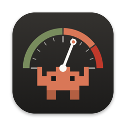
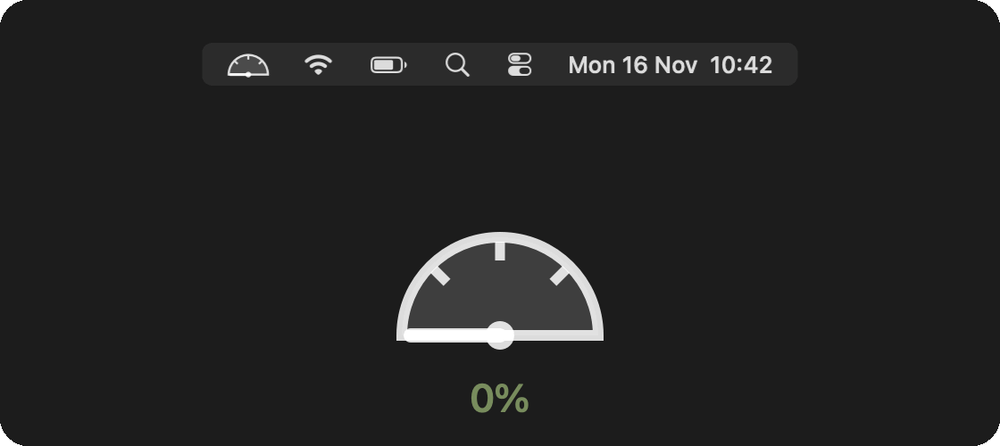
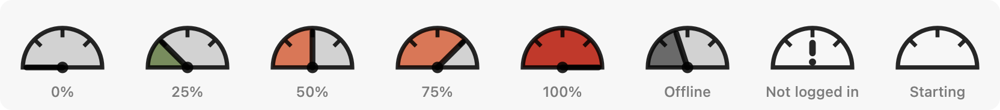
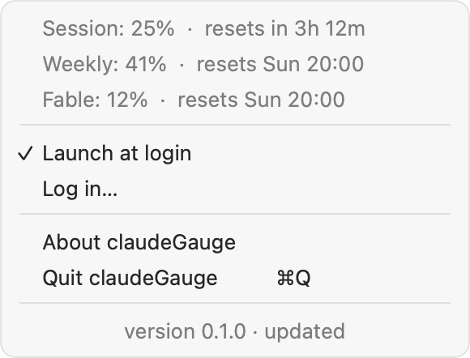

<p align="center">
  
</p>

<h1 align="center">claudeGauge</h1>

<p align="center">
  <b>A tiny speedometer in your Mac's menu bar that shows how much of your Claude usage limit you have used.</b>
</p>

<p align="center">
  
</p>

<p align="center">
  <a href="https://github.com/rasrenan/claudegauge/releases/latest/download/ClaudeGauge.dmg"><b>⬇️ Download for macOS</b></a>
  &nbsp;·&nbsp; Free and open source &nbsp;·&nbsp; macOS 14+
</p>

<p align="center"><sub>Unofficial project, not affiliated with or endorsed by Anthropic. Claude is a trademark of Anthropic.</sub></p>

---

## What is this?

If you use **Claude** (claude.ai or Claude Code) on a Pro or Max plan, your usage
is limited in **5-hour sessions**: once you hit 100% you have to wait for the
session to reset. There is also a **weekly** limit on top of that.

You normally only find out how close you are when you open the usage page, or
when Claude stops you.

**claudeGauge puts that number in front of you all the time.** It lives in the
macOS menu bar, next to Wi-Fi and the clock, as a small dial. The needle moves
up as you use Claude, like a car's speedometer.

**At 25% of the session** the dial is mostly empty and green:

<p align="center">
  <picture>
    <source media="(prefers-color-scheme: dark)" srcset="docs/images/menubar-25-dark.png">
    
  </picture>
</p>

**At 75% of the session** the needle has passed the top and the dial turns amber.
Time to slow down:

<p align="center">
  <picture>
    <source media="(prefers-color-scheme: dark)" srcset="docs/images/menubar-75-dark.png">
    
  </picture>
</p>

It updates by itself every minute. You don't have to open anything.

## How to read the dial

The dial is the top half of a circle.

- **The needle starts lying flat on the left (0%)** and turns **clockwise** as
  you use Claude. It points straight up at 50% and lies flat on the right at
  100%.
- **The area the needle has passed over is painted**, so you can tell the level
  at a glance even without looking at the needle.
- **Three small ticks** mark 25%, 50% and 75%.
- **The colour tells you how worried to be:**

| Colour | Session usage | Meaning |
|---|---|---|
| 🟢 Green | below 50% | Plenty left |
| 🟠 Amber | 50% to 79% | Over half used |
| 🔴 Red | 80% and above | Close to the limit |

<p align="center">
  <picture>
    <source media="(prefers-color-scheme: dark)" srcset="docs/images/states-dark.png">
    
  </picture>
</p>

There are also three special states:

- **Offline** (grey): the Mac has no internet. The needle stays at the last
  known value until the connection is back.
- **Not logged in** (`!`): claudeGauge can't find a valid Claude login. See
  [Logging in](#logging-in).
- **Starting** (empty dial): shown for a few seconds while the first reading
  comes in.

To see the exact percentage, **hover over the dial**. A tooltip shows it.

## The menu

Click the dial to open its menu:

<p align="center">
  <picture>
    <source media="(prefers-color-scheme: dark)" srcset="docs/images/menu-dark.png">
    
  </picture>
</p>

| Item | What it does |
|---|---|
| **Session** | Usage of the current 5-hour session and how long until it resets. This is what the dial shows. |
| **Weekly** | Usage of your 7-day limit and when it resets. |
| **Fable** | Weekly usage of the Fable model. **Only shown if your account has a Fable limit.** |
| **Launch at login** | When ticked, claudeGauge starts automatically every time you turn on your Mac. |
| **Log in…** | Logs you in to Claude if claudeGauge says you're not logged in. It is shown in **bold** when you need it. |
| **About claudeGauge** | Opens this project's page on GitHub in your browser. |
| **Quit claudeGauge** | Closes the app and removes the dial from the menu bar. |
| **version / Update now** | Shows the installed version. Says *updated* when you're on the latest release, or shows **Update now** when there's a new one. |

## Requirements

- A Mac with **macOS 14 (Sonoma) or later**
- **[Claude Code](https://claude.com/claude-code)** installed and logged in at
  least once. claudeGauge reuses its login, so there is no separate account or
  password.

## Install

There are two ways to install. **Option 1 needs no Terminal and no Xcode.**

### Option 1: download the app (recommended)

<p align="center">
  <a href="https://github.com/rasrenan/claudegauge/releases/latest/download/ClaudeGauge.dmg"><b>⬇️ Download ClaudeGauge.dmg</b></a>
</p>

1. Open the downloaded **ClaudeGauge.dmg**. A window shows the claudeGauge
   app, your **Applications** folder and a **How to install.txt** file with
   these same steps.
2. **Drag claudeGauge onto Applications.**
3. Open your **Applications** folder and double-click **claudeGauge**.
4. macOS says it *"could not verify claudeGauge is free of malware"*. That is
   expected: claudeGauge is free and isn't signed with a paid Apple developer
   account. Close the message with **Done** (not *Move to Trash*).
5. Open **System Settings → Privacy & Security**, scroll to the bottom and click
   **Open Anyway** next to the claudeGauge message. Confirm with your password
   or Touch ID, then click **Open Anyway** again. You only do this once.
6. macOS asks whether `security` may use "Claude Code-credentials" from your
   keychain. Click **Always Allow**. This is how claudeGauge reads your Claude
   login. If you click *Deny*, the dial shows `!`.
7. The dial appears in the menu bar. Click it and tick **Launch at login** so
   it starts with your Mac.

The app works on both Apple Silicon and Intel Macs.

### Option 2: build from source

You need **Xcode** (free on the Mac App Store).

1. Download this repository (green **Code** button → **Download ZIP**, or
   `git clone`).
2. Open **Terminal** in the downloaded folder and run:

   ```bash
   ./install.sh
   ```

   This builds the app, copies it to your **Applications** folder and opens it.
   Because you built it yourself, macOS doesn't show the malware warning.
3. Do steps 6 and 7 of Option 1 (allow the keychain prompt, tick **Launch at
   login**).

## Logging in

claudeGauge doesn't have its own account. It uses the login that **Claude
Code** already saved on your Mac.

If the dial shows `!` (not logged in), click it and choose **Log in…**. A
Terminal window opens and runs `claude auth login`, which opens your browser to
sign in to Claude. Once you've signed in, the dial comes back by itself within
about a minute and a half.

## Uninstall

1. Click the dial and untick **Launch at login**.
2. Click the dial and choose **Quit claudeGauge**.
3. Delete **ClaudeGauge** from your **Applications** folder.

## Updates

claudeGauge checks GitHub for a new version shortly after it starts and then
once a day. When one exists, the bottom line of the menu shows **Update now**.
Clicking it downloads the new version from this repository's Releases, checks
it, replaces the app and reopens it. There are no warnings and no repeated
Open Anyway. Otherwise the line says "updated". If the app isn't in
Applications, the button opens the download page instead.

## Questions

**Why does macOS say it "could not verify claudeGauge is free of malware"?**
Because claudeGauge is free and isn't signed with a paid Apple Developer ID
($99/year), not because anything is wrong with it. The full source code is in
this repository, and you can build it yourself instead (Option 2). You only
allow it once (*Open Anyway*); updates installed from the menu don't show the
warning again.

**Does claudeGauge use up my Claude quota?**
Barely. Once a minute it sends Claude the smallest possible request (one word,
one token of reply) and reads the usage numbers that come back with the answer.
The effect on your limit is negligible.

**Where does my login go?**
Nowhere new. claudeGauge reads Claude Code's token from your Mac's keychain and
sends it **only to Anthropic's API** (`api.anthropic.com`), the same place
Claude Code sends it. Nothing is stored or sent anywhere else, and claudeGauge
never refreshes or changes your login.

**The dial is grey.**
You're offline, or Anthropic's API didn't answer. It recovers by itself.

**Why is the Fable line missing?**
Your account has no Fable limit, or claudeGauge hasn't read it yet. The Fable
number is checked every 5 minutes.

**Does claudeGauge contact anything besides Anthropic?**
Once a day it asks GitHub (`api.github.com`) whether there is a newer release.
That request contains no personal data, but like any web request it reveals
your IP address to GitHub.

**Does it work without Claude Code?**
No. Claude Code provides the login. Install it and log in once.

## How it works (technical)

- **Login:** the OAuth token is read from the keychain item Claude Code creates
  (`Claude Code-credentials`) using Apple's `security` command. The app never
  refreshes the token; Claude Code does.
- **Session and weekly usage:** every 60 s, and when the Mac wakes from sleep,
  the app sends a 1-token request to `claude-haiku-4-5` and reads the
  `anthropic-ratelimit-unified-5h-*` and `-7d-*` response headers. An HTTP 429
  still carries those headers, so it counts as a valid reading.
- **Fable usage:** read from `/api/oauth/usage` every 5 minutes. That endpoint
  rate-limits easily, so on HTTP 429 the wait doubles (5 → 10 → 20 → 30 min) and
  the last value is kept, including across restarts.
- **No Dock icon:** it is a menu bar-only app (`LSUIElement`).

## Development

The app is written in Swift with AppKit and has no third-party dependencies.

```
ClaudeGauge/          app sources (one responsibility per file)
  TokenReader.swift     reads Claude Code's login from the keychain
  UsageClient.swift     asks the API and parses the usage headers
  FableClient.swift     Fable weekly usage, with rate-limit back-off
  UsagePoller.swift     60 s timer and the ok / offline / not-logged-in state
  GaugeIcon.swift       draws the dial
  StatusMenu.swift      the menu bar item and its menu
  LoginLauncher.swift   "Log in…" (opens Terminal with `claude auth login`)
  ResetFormatter.swift  "resets in 2h 13m" text
  Theme.swift           the green / amber / red colours
  UpdateController.swift  update state and the daily check
ClaudeGaugeTests/     unit tests (XCTest)
tools/                icon, README image and .dmg builders
packaging/            files shipped inside the .dmg
project.yml           XcodeGen project definition
```

Run the tests:

```bash
DEVELOPER_DIR=/Applications/Xcode.app/Contents/Developer \
  xcodebuild -project ClaudeGauge.xcodeproj -scheme ClaudeGauge \
  -destination 'platform=macOS' -derivedDataPath build test
```

Other useful commands:

- `xcodegen generate` regenerates `ClaudeGauge.xcodeproj` after adding files
  (`brew install xcodegen`).
- `./tools/make-icon.sh` regenerates the app icon.
- `./tools/make-readme-images.sh` regenerates the images in this README.
- `./tools/make-dmg.sh` builds a universal Release and packages it as
  `build/ClaudeGauge.dmg` (app, Applications shortcut and
  `packaging/How to install.txt`). Attach that file to a GitHub Release named
  after the version (e.g. `v0.1.0`) so the download link above points to it.

### Publishing a new version

1. Set `CFBundleShortVersionString` in `project.yml` (three levels, e.g.
   `0.2.0`) and run `xcodegen generate`.
2. Run `./tools/make-dmg.sh`.
3. Create a GitHub Release whose tag is `v<version>` (e.g. `v0.2.0`) and attach
   `build/ClaudeGauge.dmg` (the file name must stay `ClaudeGauge.dmg`).

Installed copies pick it up within a day. The app installs whatever the latest
release contains, so keep two-factor authentication on the GitHub account.

### Manual test checklist

1. The dial appears and the hover percentage matches Claude's usage page.
2. Turn Wi-Fi off and the dial turns grey. Turn it on and the dial recovers within 60 s.
3. Run `claude auth logout` and the dial shows `!`. Use **Log in…** to log back
   in and the dial recovers.
4. Turn **Launch at login** on and reboot: the app is running. Turn it off and
   reboot: the app is not running.
5. **Quit claudeGauge** removes the dial.

## Credit

Inspired by [Clawdmeter](https://github.com/HermannBjorgvin/Clawdmeter), an
ESP32 desk display for Claude usage. No code or assets are copied from it. The
icon and the dial are original drawings made in code.

claudeGauge is an independent, unofficial project. It is not affiliated with,
endorsed by or sponsored by Anthropic. "Claude" and "Claude Code" are
trademarks of Anthropic, used here only to describe what the app works with.

## Licence

MIT. See [LICENSE](LICENSE).
